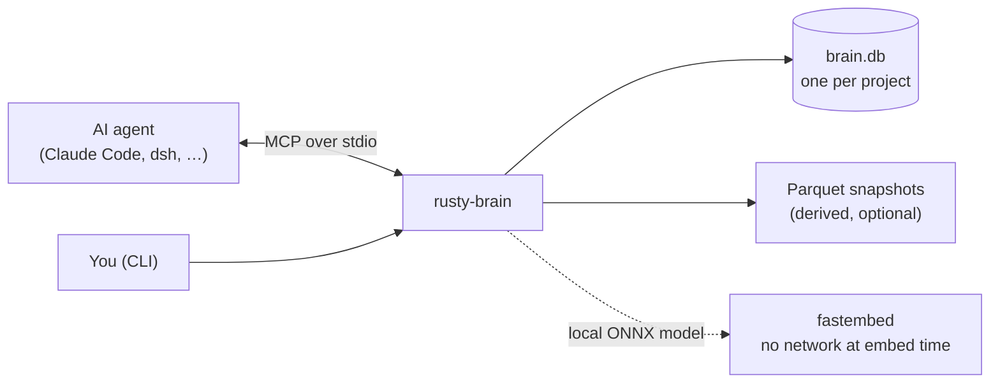
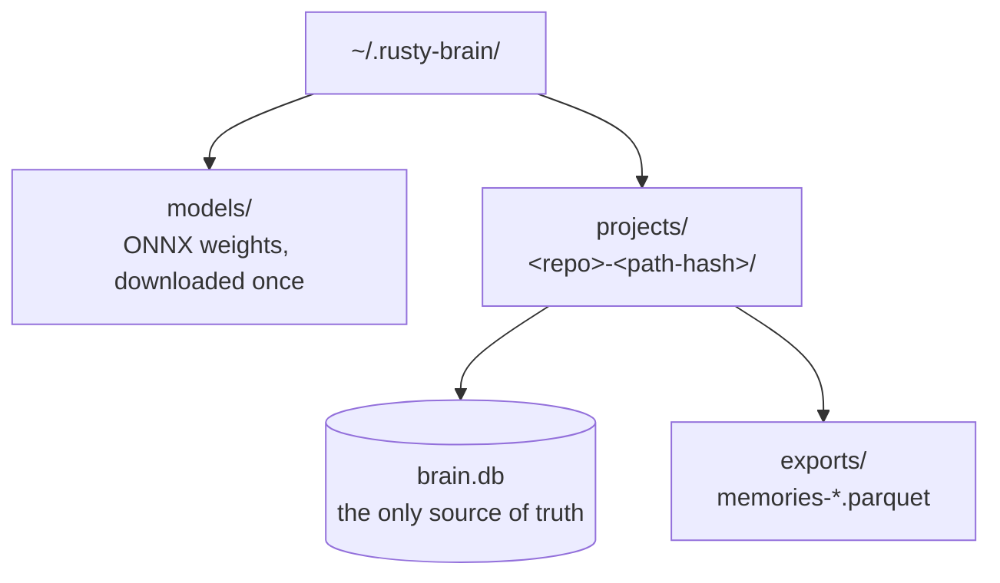
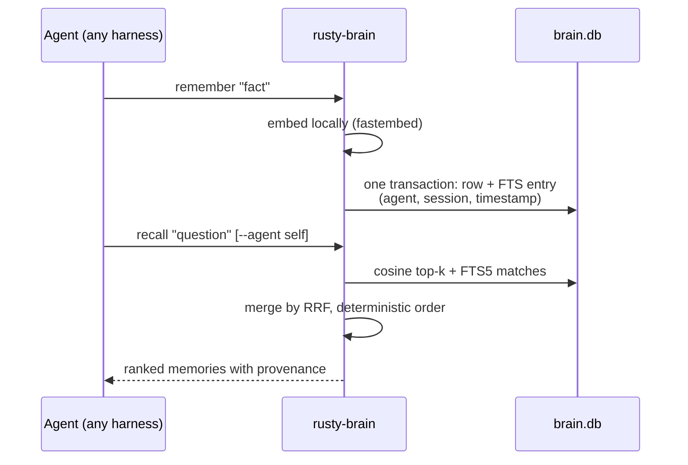
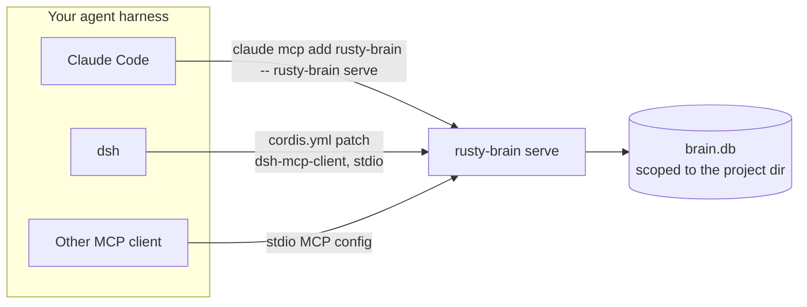
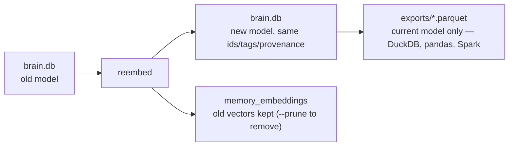

# rusty-brain

Local memory for AI coding agents. One binary, one SQLite file per project,
embeddings computed **on your machine**. No accounts, no API keys, no telemetry.



## What it does

| Command / tool | What it does |
|---|---|
| `remember <text>` | Store a fact, embedded locally, tagged with your agent + session |
| `recall <query>` | Hybrid search: meaning (vectors) + keywords (FTS5), merged by RRF |
| `recall <query> --agent self\|others\|<name>` | Recall only your own memories, other agents', or one agent's |
| `forget <id>` | Soft-delete a memory (one transaction, disappears everywhere) |
| `recent`, `stats` | Latest memories; counts per agent, model, file size |
| `path` / `data_path` | Show exactly where your data lives |
| `export` | Write a new Parquet snapshot (derived; the brain file stays the truth) |
| `reembed <model>` | Regenerate every vector with another embedding model |
| `use-model <id>` | Select existing vectors without re-embedding (requires full active coverage) |
| `models` | List supported embedding models |
| `setup-mlx` | Install the optional MLX (Metal) sidecar + model (one-time) |
| `serve` | MCP server on stdio — how agents mount it |

## How memory is organized



- **One brain per project** (from the directory you launch the agent in). Two
  checkouts of the same repo never share a brain — the slug hashes the absolute path.
- **Every memory records `agent` and `session`**, so several agents can share a
  project brain and still recall only their own, or each other's.
- **One embedding model per brain** — new brains default to
  `mlx-modernbert-4bit` (768-dim, Metal via the MLX sidecar after
  `setup-mlx`). The CPU fastembed arms such as `BGESmallENV15Q` (384-dim,
  local ONNX) stay selectable with `RUSTY_BRAIN_MODEL`. Mixing embedding
  spaces is refused. Switch models with `reembed`.
- Delete a project = `rm -rf` its directory. There is nothing else, anywhere else.
- On Unix, data/project/export directories are `0700`; `brain.db` and Parquet
  exports are `0600`. Agent/project fields are conveniences inside this trusted
  single-user boundary, not authorization or tenant isolation.

## Remember → recall



## Use it

### 1. Install

```bash
cargo install --path .
rusty-brain path        # shows where every byte lives
```

### 2. Try it

```bash
rusty-brain remember "We reuse one DuckDB instance per customer" --tags decision
rusty-brain recall "how do we route duckdb jobs"
rusty-brain recall "duckdb" --agent others   # what other agents learned
rusty-brain stats
rusty-brain forget <id>          # soft-delete one memory
rusty-brain models               # supported embedding models
```

### 3. Mount it in your agent



**Claude Code** (per project):

```bash
cd <your project>
claude mcp add rusty-brain -e RUSTY_BRAIN_AGENT=claude-code -- rusty-brain serve
```

**deepseek-harness (dsh)**: set `RB` to the **absolute** rusty-brain checkout,
then change to the target project before launching with the shipped overlays:

```bash
RB=/absolute/path/to/rusty-brain
cd /absolute/path/to/your-target-project
dsh --profile headless \
  --patch "$RB/examples/deepseek-harness/ollama-local.cordis.yml" \
  --patch "$RB/examples/deepseek-harness/rusty-brain.cordis.yml"
```

The overlay records `agent=dsh`, `session=dsh-headless`, and scopes the brain to
the target project's cwd (or `RUSTY_BRAIN_PROJECT` when explicitly set).

**Any MCP client**: `{ "command": "rusty-brain", "args": ["serve"] }` with
`RUSTY_BRAIN_AGENT` / `RUSTY_BRAIN_SESSION` set in the mount's env. Set the
client's cwd to the target project, or use explicit args
`["--project", "<project-slug>", "serve"]` when the client cwd differs.

### 4. Snapshots and model migration

```bash
rusty-brain export                          # new Parquet file, DuckDB-readable
rusty-brain reembed SnowflakeArcticEmbedMQ  # regenerate with a better/larger model
rusty-brain use-model BGESmallENV15Q        # select retained vectors; no inference
```



Re-embedding **always regenerates every vector** (old vectors are never reused)
and keeps ids, tags, timestamps, agent and session. By default, old models'
vectors stay in `memory_embeddings`. Once every active memory has a valid vector
for another model, `use-model <id>` switches to it with a metadata pointer flip
and no model loading or inference; it refuses incomplete coverage. To remove old
vectors: `reembed <model> --prune` (previous model only) or `--prune-all` (every
older model); the two flags conflict. Exports include **only the current model's
embedding** per memory.

## Metal acceleration (optional)

New brains default to `mlx-modernbert-4bit` (768-dim ModernBERT, Apache-2.0),
embedded on Apple Metal through a small self-owned Python sidecar — one-time
setup, then fully local:

```bash
rusty-brain setup-mlx   # sidecar + pinned venv + ~80 MB model (needs uv once)
```

Without setup, remember/recall on a new brain fails with actionable guidance:
"run `rusty-brain setup-mlx` …". The CPU fastembed arms stay available: set
`RUSTY_BRAIN_MODEL=BGESmallENV15Q` (or `AllMiniLML6V2Q`,
`SnowflakeArcticEmbedMQ`) for a new brain, and `reembed`/`use-model` to move an
existing one between models. Numbers and licenses:
[docs/models.md](docs/models.md).

## Troubleshooting

### 1. Missing or incomplete model cache

- **Observable symptom:** An offline remember/recall exits nonzero, MCP returns `isError: true`, and the diagnostic says the first run must download the model; no brain should be created for a new project.
- **Likely cause:** `BGESmallENV15Q` is absent or incomplete under `$RUSTY_BRAIN_HOME/models`, or the command selected a different home.
- **Corrective action:** With network enabled, rerun `scripts/verify-local.sh` against the same `$VERIFY_ROOT`; confirm a non-empty file exists under `$RUSTY_BRAIN_HOME/models`, then rerun the offline and probe checks.

### 2. Unavailable dsh, Ollama, or local model

- **Observable symptom:** `dsh --version`, `ollama --version`, or `ollama show qwen3.8:27b-mlx` fails, the model lacks `tools`, or `verify-dsh.sh` exits before `H3 PASS`.
- **Likely cause:** dsh/Ollama is not installed or on `PATH`, Ollama is not running, or the pinned local model is absent or not tool-capable.
- **Corrective action:** Install/select dsh 0.1.1-rc.2 and Ollama 0.40.15, start Ollama, make `qwen3.8:27b-mlx` locally available, verify `ollama show` reports tools, and rerun the live script without enabling hosted fallback.

### 3. Missing rusty-brain executable

- **Observable symptom:** `test -x "$BIN"` fails, `rusty-brain` is not found, or the MCP child cannot start.
- **Likely cause:** Installation did not complete, or `$VERIFY_ROOT/install/bin` is absent from the client `PATH`.
- **Corrective action:** Run the documented offline isolated install, verify `test -x "$VERIFY_ROOT/install/bin/rusty-brain"`, prepend that directory to `PATH`, and rerun composition and the live check.

### 4. Invalid mount, config, cwd, or override

- **Observable symptom:** `verify_dsh_config.py` rejects literal `!!js` fields, tools do not appear, or live `data_path`, session `meta.cwd`, and the isolated database disagree.
- **Likely cause:** The profile/patch order is wrong, `RUSTY_BRAIN_HOME`/`RUSTY_BRAIN_PROJECT` is missing or inconsistent, or dsh was launched outside `$VERIFY_ROOT/work/project`.
- **Corrective action:** Use both shipped overlays in the documented order, preserve the literal expressions, export both overrides, launch from the documented temporary cwd, and rerun structural plus live checks; never resolve the expressions by editing the YAML.

### 5. Failed Parquet or DuckDB readback

- **Observable symptom:** `verify_parquet.py` reports a column/type, row-count, metadata, or float32 mismatch, or DuckDB cannot read a snapshot.
- **Likely cause:** The database and Parquet paths belong to different projects/snapshots, the reported count is not the selected row count, or the reader is not DuckDB 2.0.0.
- **Corrective action:** Use the matching `brain.db` and export printed by the same run, pass its printed count, run through `uv run --isolated scripts/verify_parquet.py`, and inspect the eight-column schema; do not repair or overwrite the source or prior snapshot.

### 6. Failed network-denial positive control

- **Observable symptom:** The outside curl does not succeed, the sandboxed curl succeeds, the ready-cache probe observes a connection/request, or the empty-cache control observes none.
- **Likely cause:** External network is unavailable for the outside control, `sandbox-exec` is not enforcing `tests/fixtures/no-network.sb`, the model cache is not ready, or the probe endpoint/state is stale.
- **Corrective action:** Restore initial-download connectivity, use a fresh `$VERIFY_ROOT`, rerun `verify-local.sh`, and require outside=0/inside nonzero plus zero ready-cache and at least one empty-cache observation before trusting offline evidence.

## Verification

```bash
cargo test --offline                                  # tests, no model download
VERIFY_ROOT=$(mktemp -d /tmp/rusty-brain-verify.XXXXXX) scripts/verify-local.sh
VERIFY_ROOT=<same root> scripts/verify-dsh.sh         # real dsh + Ollama run
RUSTY_BRAIN_MLX_E2E=1 scripts/verify-mlx.sh           # live MLX/Metal run (~80 MB)
```

Verified on macOS arm64 (Rust 1.97): offline embeddings under active network
denial, DuckDB-readable Parquet (including empty brains), and a real local
dsh+Ollama agent completing remember → recall → stats → forget. Details and
evidence: [docs/verification.md](docs/verification.md).

Docs: [Parquet schema](docs/parquet-schema.md) ·
[MCP compatibility](docs/mcp-compatibility.md) ·
[models & licenses](docs/models.md) ·
  [stack & learnings](https://github.com/cryolake/leki-context-hub/tree/main/specs/006-rusty-brain-local-verify)
